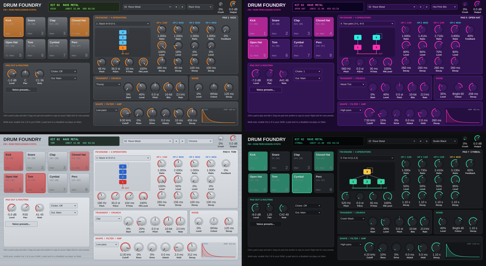

# Drum Foundry (working name)

A 90s rompler / FM percussion synth (VST3 + AU + standalone). It has 8 drum pads. Each pad blends a 4-operator FM engine,
a crunchy low-bitrate transient sample and a noise layer, then runs them through a filter and an amp envelope. You get
16 factory kits, a library of 24 voice presets, choke groups, 8 stereo multi-outs and four UI themes.
See `docs/DESIGN.md` for the signal flow and the decisions behind it.



## Build

CI (`.github/workflows/build.yml`) builds universal macOS (11+) VST3 + AU + standalone and Windows x64 VST3 + standalone,
runs the engine tests, makes a macOS `.pkg` and a Windows `Setup.exe`, and attaches both to a GitHub Release on `v*` tags.

```
cmake -B build -DCMAKE_BUILD_TYPE=Release            # fetches JUCE 8.0.4
# or: cmake -B build -DJUCE_DIR=/path/to/JUCE
cmake --build build --config Release
ctest --test-dir build                                # engine tests
```

macOS builds target macOS 11+ universal (Intel + Apple Silicon). No AVX2 or other `-march` flags are used;
the DSP is scalar C++. Windows builds use the static runtime.

Screenshots: configure with `-DDRUMFOUNDRY_BUILD_SCREENSHOTS=ON`, build `DrumFoundryShots`, then run
`DrumFoundryShots docs/screenshots` (on Linux, run it under `xvfb-run`).

Layout: `Source/engine` is plain C++ (FM voices, transient set, crusher, kits) with tests in `tests/`.
`Source/plugin` is the JUCE wrapper, themes and UI. `tools/Screenshots.cpp` renders the docs images.

## Playing it

The default note map is GM, so drum MIDI files (for example stem-scribe's drum-to-MIDI output) play straight away:
36 kick, 38 snare, 39 clap, 42/46 closed/open hat, 45 tom, 49 cymbal, 37 perc. Common GM neighbours are aliased too:
35 kick, 40 snare, 44 hat, 41/43/47/48/50 tom, 51/52/55/57/59 cymbal. Each pad's note can be changed.
